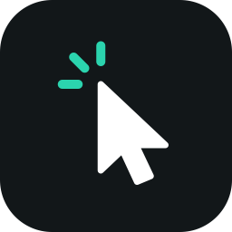

<p align="center">
  
</p>

<h1 align="center">Clickity</h1>

<p align="center">
  <b>The free, open-source Screen Studio alternative for macOS.</b><br>
  Record your screen, and Clickity turns every click into a polished video.
</p>

---

Clickity lives in the menu bar. It records your screen together with your cursor, clicks and
keystrokes. Then it makes the take look good for you: it zooms in where you click, redraws a
smooth cursor, and puts the video on a styled background.

If you know Screen Studio, you know the idea: automatic zooms, a smooth cursor, a nice
background and fast export. Clickity does that for free, with screenshots in the style of
CleanShot X built in.

## Install

You need:

- macOS 15.2 or later
- Xcode 26 or later
- An "Apple Development" or "Developer ID Application" certificate in your keychain

There are no prebuilt downloads yet. Build and install from source:

```sh
git clone https://github.com/rezaulhreza/clickity.git
cd clickity
scripts/install.sh
```

The script builds the app, installs it as `/Applications/Clickity.app` and opens it.

On first launch:

1. Find the Clickity icon in the menu bar.
2. Allow **Screen Recording** and **Input Monitoring** when macOS asks. Input Monitoring lets
   Clickity see your clicks, which is what it zooms in on.
3. Quit Clickity and open it again.

Microphone and camera ask for access the first time you turn them on.

To update, run `git pull`, then `scripts/install.sh` again.

## What it does

**Record**
- A whole screen, one window or an area you draw.
- System audio, microphone and camera, with a 3, 5 or 10 second countdown.
- Pause, resume, cancel or restart a take.
- HEVC, H.264 or ProRes, with HDR and transparency.

**Edit**
- Trim, split and cut. Speed up parts, or every stretch of typing at once.
- Automatic zooms on clicks, typing and where the cursor rests. Add your own on the zoom lane.
- A smooth, sharp cursor that can hide when idle. Click rings, click sounds and a keystroke overlay.
- Blur or pixelate private areas. Find emails, phone numbers and API keys for you.
- Crop, background music, voice enhancement and motion blur.
- Backgrounds: gradients, colours, your own pictures or the macOS wallpapers. Padding, rounded
  corners, shadow and border. Save a look as a style and use it again.

**Export**
- MP4 (HEVC), ProRes or GIF, at the size, frame rate and quality you pick.
- 16:9, 9:16, 1:1 and 4:3 canvases.
- Share, show in Finder or copy to the clipboard.

**Screenshots**
- Capture a screen, window or area. The screen freezes while you select, with a loupe.
- A card opens after each shot: copy, save, annotate, add a background, hide sensitive info,
  copy the text (OCR) or pin it on screen.
- Screenshot history, with the newest shots in the notch.

**Web recordings and AI agents**
- Script hovers, clicks, typing and scrolls on a live web page, then render a frame-perfect video.
- Claude Code, Codex, Cursor, Gemini CLI, OpenCode and others can inspect, browse and record web
  pages through Clickity's local MCP server (**Settings → Agents**).

**Library**
- Every recording, export and screenshot in one window, grouped by date, with search.

### Not done yet

- Captions and transcripts, and removing silences.
- Scrolling screenshots.
- The camera as its own track in the editor.
- Switching microphones mid-recording, input gain and level meters.

## Keyboard shortcuts

Change the global shortcuts in **Settings → Shortcuts**.

| Action | Shortcut |
|---|---|
| Capture area / window / screen | ⌘1 / ⌘2 / ⌘3 |
| Select what to record / an area | ⌘4 / ⌘5 |
| Start or stop recording | ⌘6 |
| Pause or resume | ⌘7 |
| Open the screenshot / recording toolbar | ⇧⌘1 / ⇧⌘2 |

<details>
<summary>Toolbar, card and editor keys</summary>

**Capture toolbar**

| Action | Key |
|---|---|
| Screen / window / area | 1 / 2 / 3 |
| System audio / microphone / camera | A / M / C |
| Capture or record | ↩ |
| Close | Esc |

**Screenshot card**

| Action | Shortcut |
|---|---|
| Copy / save | ⌘C / ⌘S |
| Close | Esc |

**Video editor**

| Action | Shortcut |
|---|---|
| Play or pause | Space |
| Previous / next frame | ← / → |
| Split at the playhead | S |
| Add a zoom / a mask | Z / M |
| Delete the selection | ⌫ |
| Copy the frame | ⇧⌘C |
| Undo / redo | ⌘Z / ⇧⌘Z |

</details>

<details>
<summary>Automation links</summary>

Open these from Terminal (`open "clickity://toggle"`), Shortcuts, Raycast or any launcher.

| Link | Action |
|---|---|
| `clickity://toggle` | Start or stop recording, without a countdown |
| `clickity://toggle-copy` | The same, then copy the file when it is saved |
| `clickity://pause` | Pause or resume |
| `clickity://cancel` | Stop and throw the take away |
| `clickity://restart` | Throw the take away and record the same selection again |
| `clickity://capture-area` | Take a screenshot (also `capture-window`, `capture-screen`, `capture-previous-area`). Add `?then=copy`, `save` or `pin` to skip the card |
| `clickity://edit-last` | Open the last recording in the editor |

</details>

## Development

- `scripts/install.sh` builds a Release app and installs it.
- `scripts/dev.sh` rebuilds and relaunches a Debug app each time you save a file
  (needs `brew install fswatch`).

Both scripts sign with your own certificate. Do not run an unsigned (ad-hoc) build: macOS then
asks for Screen Recording again after every rebuild.

To run the tests, quit Clickity first, then:

```sh
xcodebuild -scheme Clickity -destination "platform=macOS,arch=$(uname -m)" \
  CODE_SIGN_IDENTITY="Apple Development" DEVELOPMENT_TEAM=YOUR_TEAM_ID \
  CODE_SIGN_STYLE=Manual PROVISIONING_PROFILE_SPECIFIER="" test
```

Find your team ID with `security find-identity -v -p codesigning`: it is the code in brackets.

The test host is the app itself, so a running copy makes the test runner stop early.

Read [AGENTS.md](AGENTS.md) for the code rules and [docs/](docs/README.md) for the architecture.
Bug reports and pull requests are welcome: see [CONTRIBUTING.md](CONTRIBUTING.md).

## Credits

Clickity is a fork of [Orbit](https://github.com/diip3sh/orbit) by diip3sh, which is a fork of
[BetterCapture](https://github.com/jsattler/BetterCapture) by Joshua Sattler and its contributors.

## License

[MIT](LICENSE)
